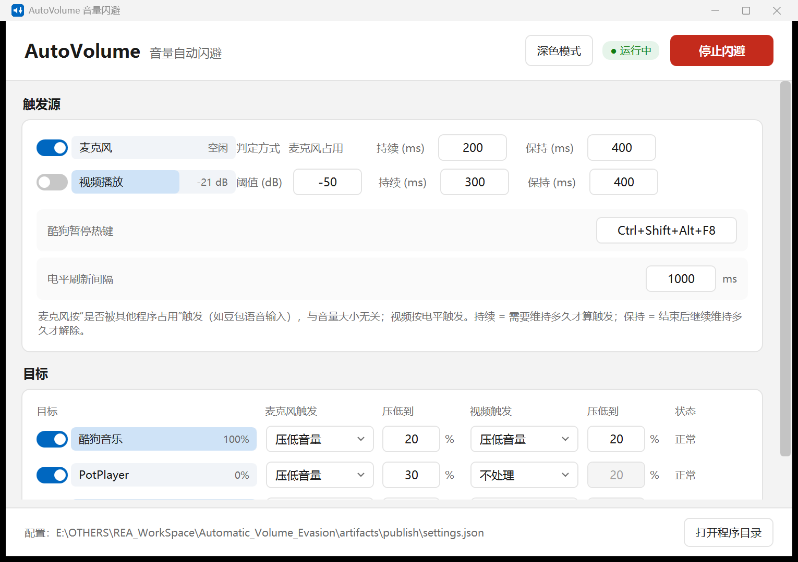
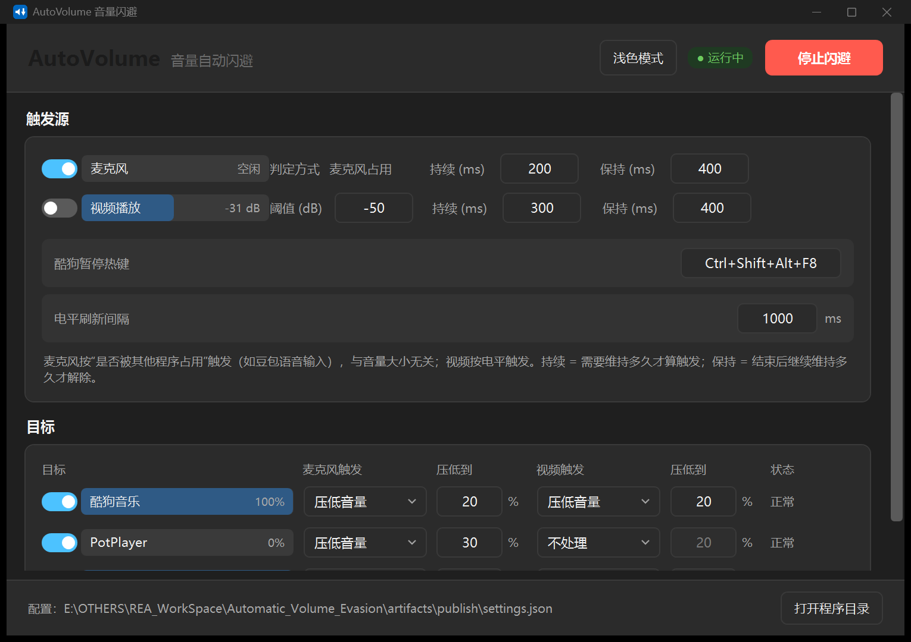

# AutoVolume 音量自动闪避





AutoVolume 是一个 Windows 托盘小工具：当它发现你**占用了麦克风**（语音输入、通话、录音）或**正在播放视频**时，会把音乐软件的音量自动压下去，或者干脆暂停；结束后再原样还回来。

不装驱动、不接管声卡、不修改系统设置，只操作 Windows 自带的「按应用音量」。

**目录**：[功能](#功能) · [工作原理](#工作原理) · [快速开始](#快速开始) · [酷狗热键](#让酷狗能够被暂停) · [参数说明](#参数说明) · [配置文件](#配置文件) · [常见问题](#常见问题) · [项目结构](#项目结构) · [从源码构建](#从源码构建) · [相关项目与致谢](#相关项目与致谢) · [更新日志](#更新日志) · [已知限制](#已知限制)

## 它解决什么问题

- 用豆包输入法、微信语音、会议软件说话时，酷狗还在放歌，听不清自己说什么。
- 在浏览器或 PotPlayer 看视频时，背景音乐干扰台词。
- 用完语音输入后，又要手动把音乐调回来。

## 功能

- **麦克风占用触发**：任何非系统进程占用麦克风时触发。按「谁占用了麦克风」判断，与说话音量无关，不会被音箱串音误触发。
- **自定义忽略列表**：界面底部可添加进程名（如语音输入工具），这些程序占用麦克风时不触发闪避；内置系统进程始终被忽略，默认不显示在列表中。
- **自定义视频触发**：视频程序列表里任一程序有声音输出时触发；视频程序由你自己增删，同时它们也是被压低的对象。
- **音乐 / 视频两类目标**：一个程序只能归入其中一类。音乐程序可以压低或暂停，视频程序只能压低，且不会被视频播放触发压低。
- **每个目标独立配置**：两条触发路径可以分别设为「不处理 / 压低音量 / 暂停播放」，压低比例和渐变速度单独可调。
- **每个音乐程序独立暂停热键**：「暂停播放」发送给该程序自己的播放 / 暂停热键。
- **实时反馈**：麦克风、视频电平和每个目标的当前音量都用分格电平条显示，压低时变成琥珀色。
- **自动恢复**：触发结束、关闭程序、甚至程序被强杀后重新启动，都会把音量还原。
- **深色模式**：右上角一键切换浅色 / 深色，标题栏、滚动条、电平条一并跟随，选择写入配置。
- **磨砂背景**：Windows 11 22H2 及以上自动启用 Mica 材质；面板半透明，文字始终落在实底卡片上保证可读，系统不支持时回退为纯色背景。
- **记住窗口**：退出时保存窗口大小与位置，下次在原处打开。
- **便携**：程序是单个 exe，配置 `settings.json` 和日志 `log.txt` 都写在 exe 同级目录。

## 工作原理

| 环节 | 做法 |
|---|---|
| 调音量 | WASAPI 会话级音量（`ISimpleAudioVolume`），即系统「音量合成器」里每根应用滑块 |
| 检测麦克风占用 | 枚举录音设备上的 capture session，有别的进程处于 Active 即视为占用 |
| 检测视频播放 | 读取视频程序列表里各会话的峰值电平，超过阈值并持续一段时间 |
| 暂停音乐程序 | 模拟你在该程序里配置的播放 / 暂停热键 |

## 系统要求

- Windows 10 / 11（x64）
- [.NET 10 桌面运行时](https://dotnet.microsoft.com/download/dotnet/10.0)（当前发布的是框架依赖版本）

## 快速开始

1. 从 [Releases](https://github.com/Lose-Memory/Automatic_Volume_Evasion/releases) 下载 `AutoVolume.exe`。
2. 放到一个**可写的普通目录**（不要放 `C:\Program Files`，否则无法写配置）。
3. 双击运行，程序缩到托盘。
4. 单击托盘图标打开设置页；右键托盘图标可以开关闪避、重置目标音量或退出。

首次运行会在 exe 旁边生成 `settings.json` 和 `log.txt`。把 exe 和 `settings.json` 一起拷走即可迁移。

## 让音乐程序能够被暂停

「暂停播放」通过模拟程序自己的热键实现，所以每个音乐程序都要单独设置：

1. 打开该程序的设置，找到 **播放 / 暂停** 快捷键，设成一个组合（例如酷狗：右上角菜单 → 设置 → 快捷键）
2. 在 AutoVolume 的「音乐程序」列表里，把该程序的「暂停热键」填成同样的组合

如果不需要暂停功能，把动作设为「压低音量」即可，无需配置热键。两个音乐程序填了同一个热键时，暂停会同时作用于它们。

## 参数说明

| 参数 | 含义 |
|---|---|
| 阈值 (dB) | 视频触发用的电平门限。低于它视为没在播放 |
| 持续 (ms) | 条件需要连续维持多久才算触发，防止误触 |
| 保持 (ms) | 条件消失后继续维持触发多久才解除，防止一句话中间的停顿导致音量抖动 |
| 压低到 | 触发时把音量降到当前值的百分之多少 |
| 渐变 (ms) | 压低 / 恢复的速度，数值越小变化越快（默认 120 ms） |
| 麦克风扫描间隔 | 多久重新检测一次麦克风占用（默认 200 ms，范围 50–5000）。调小反应更快，CPU 略增 |
| 电平刷新间隔 | 界面进度条和数字的刷新周期（默认 1000 ms，范围 100–5000） |

## 配置文件

`settings.json` 与 exe 同级，程序会自动保存。删除它即可恢复默认配置。

```jsonc
{
  "Version": 3,
  "Mic":   { "Enabled": true,  "ThresholdDb": -45, "SustainMs": 200, "HoldMs": 400 },
  "Video": { "Enabled": true,  "ThresholdDb": -50, "SustainMs": 300, "HoldMs": 400 },
  "ScanMsCapture": 200,
  "IgnoredCaptureProcesses": ["ImeService"],
  "Enabled": true,
  "RefreshMs": 1000,
  "Theme": "Light",
  "Window": { "Width": 1020, "Height": 720, "Left": 300, "Top": 160, "HasPosition": true },
  "Targets": [
    {
      "Id": "kugou", "Name": "酷狗音乐", "Processes": ["KuGou"], "Category": 0,
      "OnMic": 1, "OnMicDuckTo": 0.2, "OnVideo": 1, "OnVideoDuckTo": 0.2,
      "PauseHotkey": { "Ctrl": true, "Shift": true, "Alt": true, "Key": "F8" },
      "AttackMs": 120, "ReleaseMs": 400
    }
  ]
}
```

`Targets` 里的每一项对应界面中的一行，`Category` 为 `0` 表示音乐、`1` 表示视频。界面可以增删这些条目，一般不需要手动编辑。

`IgnoredCaptureProcesses` 是用户在界面中添加的忽略项；`svchost`、`audiodg` 等内置系统进程写死在程序里，始终被忽略，不会出现在配置文件中。

> 麦克风走的是「占用检测」，`Mic.ThresholdDb` 目前不参与判断，字段保留仅为兼容旧配置。

## 项目结构

```
Automatic_Volume_Evasion/
├── src/                     # 全部源码（C# + XAML）
├── assets/                  # README 用图
├── artifacts/               # 构建产物（git 忽略）
├── Directory.Build.props    # 统一把 bin/obj/publish 输出到 artifacts/
├── AutoVolume.slnx
├── README.md
└── LICENSE
```

## 从源码构建

```powershell
# 编译
dotnet build AutoVolume.slnx -c Release

# 发布单文件（框架依赖）
dotnet publish src/AutoVolume.csproj -c Release -r win-x64 `
  --self-contained false -p:PublishSingleFile=true -p:DebugType=None -o artifacts/publish
```

产物为 `artifacts/publish/AutoVolume.exe`（约 26 MB，其中 25 MB 是 WinRT 投影库）。

依赖：

- [NAudio](https://github.com/naudio/NAudio) 2.2.1 — WASAPI 会话与电平
- `Microsoft.Windows.SDK.NET.Ref` — GSMTC 媒体会话控制

## 相关项目与致谢

### Degath's Ducker（闭源）

作者的站点是 `www.degathsducker.weebly.com`（写在程序内嵌字符串里），网上查不到公开仓库或源码；从 PDB 路径看，作者使用芬兰语环境开发。

逆向它的可执行文件可以确认：.NET Framework 4.5 + WinForms 的单文件托盘程序，用 NAudio 的 WASAPI 会话接口逐应用调音量；支持把「麦克风」或「某个应用的音频会话」作为触发器、把应用会话作为目标；内置多套模板（`TemplateDictionary`）、三段式音量包络（attack / sustain / release）、峰值滤波器，以及键盘和手柄热键。

它的致命问题是**配置保存有缺陷**：`SaveSettings()` 只在窗口移动、窗口尺寸变化、手动「保存」这几种情况下被调用，增删触发器/目标完全不落盘，于是配置完一重启就回到旧状态。这正是本项目启动的直接原因。

### DesktopMixer（开源，无许可证）

[github.com/CameronVigil/DesktopMixer](https://github.com/CameronVigil/DesktopMixer)，C# 编写的按应用音量混合器。

架构是三层：ASP.NET Core 8 + NAudio 的后端（`AudioEngine` 每 50 ms 一个 tick）、Vue 3 前端、WebView2 桌面壳。闪避模型是「阈值 + 压低比例 + attack / hold / release」，按 exe 名聚合会话，设置用防抖 + 原子写持久化，退出前还原音量。

本项目借鉴了它按 exe 名聚合会话、只在音量真正变化时才写入、退出前还原音量这几个做法；没有沿用它的三层架构——为了这个场景引入 Web 服务器和浏览器内核太重了。

> DesktopMixer 仓库没有 LICENSE 文件，按「保留所有权利」处理。本项目没有复制它的代码，只参考了设计思路。

## 常见问题

**压低音量没反应？**

- 目标应用如果开了 WASAPI **独占模式**（例如 PotPlayer 的 WASAPI 独占输出），任何外部程序都改不了它的音量。换成共享输出，或者把动作改成「暂停播放」。
- 应用以管理员身份运行时，普通权限的 AutoVolume 控制不了它；需要同样以管理员身份启动。

**麦克风一直显示被占用？**

通常是有语音类软件（会议、录音、语音助手）长期占着录音设备。`log.txt` 里会记录占用者的进程名，关掉对应软件即可；如果希望它一直占用又不触发闪避，把它的进程名加到界面底部的「忽略的麦克风占用」里。

**酷狗暂停不生效？**

检查酷狗里的「播放 / 暂停」全局热键是否和 AutoVolume 里填的完全一致；如果热键已被其他软件占用，酷狗会注册失败。

**视频触发太灵敏或太迟钝？**

调「阈值 (dB)」：数值越高越难触发。播放时看进度条上的实时电平，把阈值设在它下面 5–10 dB 即可。

**怎么恢复默认设置？**

删除 exe 旁边的 `settings.json`，重启程序。

**为什么需要 .NET 10 桌面运行时？**

当前发布的是框架依赖单文件版，体积 26 MB。自包含版会把运行时打进 exe，体积约 95 MB，不需要额外安装。

## 已知限制

- 一个程序只能归入音乐或视频其中一类，不能同时存在于两个列表。
- 应用使用 WASAPI **独占模式**时，外部无法修改它的音量（暂停仍然有效）。
- 以管理员权限运行的应用，普通权限的 AutoVolume 无法控制。
- 框架依赖版本需要目标机器安装 .NET 10 桌面运行时。

## 更新日志

### v1.5.1

- 添加程序行改为两组等宽的「下拉选择 + 添加」和「手动输入 + 添加」，手动输入框带占位提示
- 音乐 / 视频两张列表的电平条改为等长且左端对齐，名称列固定宽度，长程序名不再被截断
- 移除页头的窗口材质下拉，只保留浅色 / 深色切换；Mica 背景在支持的系统上自动启用

### v1.5.0

- 界面改用 Win11 风格：窗口可选用 Mica / Acrylic 磨砂背景，面板改为半透明卡片、8 px 圆角
- 全局字号放大一级，正文与控件从 12–13.5 px 提升到 13–15 px
- 添加程序时默认过滤「仅正在出声」；下拉候选项与手动输入分成两组，中间用分隔线隔开
- 窗口加了半透明底色，磨砂背景下文字对比度依然达标（浅色深色都一样）

### v1.4.0

- 目标分为「音乐程序」和「视频程序」两张列表，程序由你自己增删，不再写死在代码里
- 视频程序列表同时充当视频播放触发源；视频播放不再压低视频程序自身
- 每个音乐程序可单独配置暂停热键，暂停方式统一为模拟该程序的热键
- 新增「麦克风扫描间隔」参数，默认 200 ms，麦克风触发到开始压低的延迟从约 0.58 秒降到约 0.18 秒
- 新增每个目标的「渐变」参数，可调压低 / 恢复速度
- 旧版配置自动迁移，原有设置与热键保留

### v1.3.0

- 界面重做为调音台式的信号面板：LED 分格电平条、细线分栏、琥珀色只表示「正在压低」
- 浅色模式正文改为近黑，深色模式提高文字与背景的对比度，不再使用绿色
- 修复松开麦克风后目标音量停在 99% 而不回到原音量的问题

### v1.2.0

- 新增「忽略的麦克风占用」列表，可自定义哪些程序占用麦克风时不触发闪避
- 内置系统进程始终忽略，默认隐藏，可用开关查看
- 界面顶部显示当前版本号

### v1.1.0

- 新增深色模式，标题栏、滚动条、进度条一并跟随
- 记住窗口大小与位置，下次在原处打开
- 修复窗口打开时滚动区被焦点带偏、顶部标题被裁切的问题

### v1.0.0

- 首个版本：麦克风 / 视频两种触发，按目标压低音量或暂停播放
- 麦克风按「占用检测」触发，不受音箱串音影响
- 配置写在 exe 同级 `settings.json`，退出或异常后自动还原音量

## 许可证

[MIT](LICENSE)

---

<sub>English: A Windows tray utility that automatically ducks (or pauses) your music while you use a microphone or play video, built on WASAPI session volumes. Requires the .NET 10 Desktop Runtime.</sub>

<sub>本项目的代码与文档由 AI 助手（Claude Code）辅助完成，作者负责需求、验证与审核。</sub>